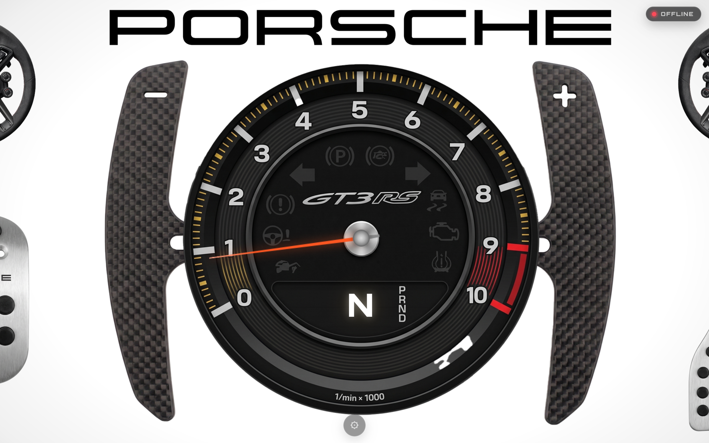

# GT3 RS Virtual Cockpit

A browser cockpit that drives a home-built ESP32 RC drift car styled after the Porsche 911 GT3 RS.
The page is the car's controller: steering wheels, shift paddles and pedals are touch (or keyboard)
controls, a physics model of the real GT3 RS gearbox decides how much power the motor gets, and an
FMOD engine sound follows the revs.



## Features

- **Live tachometer** drawn on canvas, with gear display, RPM readout and a 9,000 rpm redline
- **Drivetrain model** using the 992 GT3 RS gear ratios: each gear has its own top speed, revs drop on
  upshifts, and lifting off gives engine braking
- **Motor control from the model**: the app streams `MOTOR:0..255` to the car 25 times a second, with a
  short power cut on every upshift and an on/off stutter at the rev limiter
- **Engine sound from real dyno loops**: 23 loops pitched to the live RPM and cross-faded, with shift
  cracks, downshift blips, overrun pops and a fuel-cut limiter (FMOD and a synth as fallbacks)
- **Touch and keyboard controls**, with an on-screen key guide
- **Demo mode** when no car is connected, so anyone can try it in a browser
- **Fail-safe**: the car stops on its own if the app goes quiet for 300 ms (tab closed, phone asleep,
  Wi-Fi drop)

## Tech stack

| Part | Built with |
| --- | --- |
| Web app | Plain HTML, CSS and JavaScript (no framework, no build step), Canvas, Web Audio |
| Sound | Web Audio sample engine, FMOD Studio HTML5 runtime (WebAssembly) as fallback |
| Local server | Node.js, built-in modules only (`server.js`) |
| Car | ESP32 (Arduino), WebSockets, MX1508 dual H-bridge, optional servo |
| Link | WebSocket over the ESP32's own Wi-Fi hotspot |

## Run it

You need [Node.js](https://nodejs.org) (LTS). Nothing else to install.

```bash
npm start
```

That serves the app at http://localhost:8000 and opens it in your browser. With no car connected it
runs in demo mode. Press Ctrl+C to stop.

Why a server instead of double-clicking `index.html`? Browsers block the sound engine from loading its
`.wasm` and `.bank` files over `file://`, so the app needs to be served over `http://localhost`.

### Controls

| Action | Touch | Keyboard |
| --- | --- | --- |
| Throttle | Hold the right pedal | W / ↑ |
| Brake | Hold the left pedal | S / ↓ |
| Steer | Hold the left / right steering wheel | A / D or ← / → |
| Shift up | Tap the + paddle | E |
| Shift down | Tap the − paddle | Q or R |
| Key guide | | H or ? |
| Settings | ⚙ button | |

## Hardware

```
 Browser (laptop / phone)                         ESP32 on the car
 ┌─────────────────────────┐   WebSocket over    ┌──────────────────────────┐
 │ Cockpit UI + gearbox    │   the car's Wi-Fi   │ WebSocket server :81     │
 │ model + engine sound    │ ──────────────────► │ MX1508 ─► drive motor    │
 │                         │ MOTOR, BRAKE, STEER │        ─► steering motor │
 │                         │ ◄────────────────── │ servo  ─► shift "kick"   │
 └─────────────────────────┘   {"gear":"3"}      └──────────────────────────┘
```

- ESP32 dev board running as its own Wi-Fi access point
- MX1508 dual H-bridge: one channel for the rear drive motor, one for the steering motor
- Optional servo that gives the chassis a small kick on each gear change

Firmware, wiring and a step-by-step flash-and-test guide are in [`firmware/`](firmware/HOW-TO-FLASH-AND-TEST.md).
The hotspot password lives in `secrets.h`, which is git-ignored; copy `secrets.example.h` to start.

### Protocol

App to car: `MOTOR:0..255`, `BRAKE:0..255`, `STEER:-255..255`, `SHIFT_UP`, `SHIFT_DOWN`
(plus `THROTTLE:0..255`, used by the app's own model).
Car to app: JSON such as `{"gear":"3"}`. The app works out RPM itself, so the needle never fights the car.

## Project structure

```
index.html, styles.css      the page and its look
app.js                      controls, tachometer, drivetrain model, WebSocket link
audio-manager.js            picks FMOD or the synth fallback
sample-engine.js            dyno-loop engine sound, shifts and pops
fmod-wrapper.js             loads the FMOD runtime and sound banks
engine-audio.js             Web Audio synth fallback
wasm/, sfx/                 FMOD runtime, sound banks, engine loops and effects
server.js, package.json     tiny local web server (npm start)
firmware/                   ESP32 sketch and flashing guide
docs/                       screenshots
```

## How the engine sound works

The engine note comes from 23 short loops cut from a 992 GT3 RS dyno recording (`sfx/engine/`):
14 on-throttle loops from 1840 to 8500 rpm, 6 off-throttle loops and 3 idle loops.
`sample-engine.js` keeps them all looping, pitches each one to the current RPM and blends the two nearest.

It also makes the shift and overrun effects (`sfx/fx/`): upshifts cut the note for about 70 ms with a crack
scaled by throttle and revs, downshifts blip, lifting off at high revs gives a few random pops, and
8,900 rpm on full throttle bounces off a fuel-cut limiter.

To hear the older FMOD sound instead, open `http://localhost:8000/?sound=fmod`.

## Credits and notes

- The engine loops are edited from a third-party dyno recording and are included only for this
  non-commercial demo.
- The fallback sound uses the [FMOD Studio](https://www.fmod.com) HTML5 runtime, © Firelight Technologies,
  under the FMOD license.
- This is a personal, non-commercial fan project. Porsche, 911 and GT3 RS are trademarks of
  Dr. Ing. h.c. F. Porsche AG; this project is not affiliated with or endorsed by Porsche.
